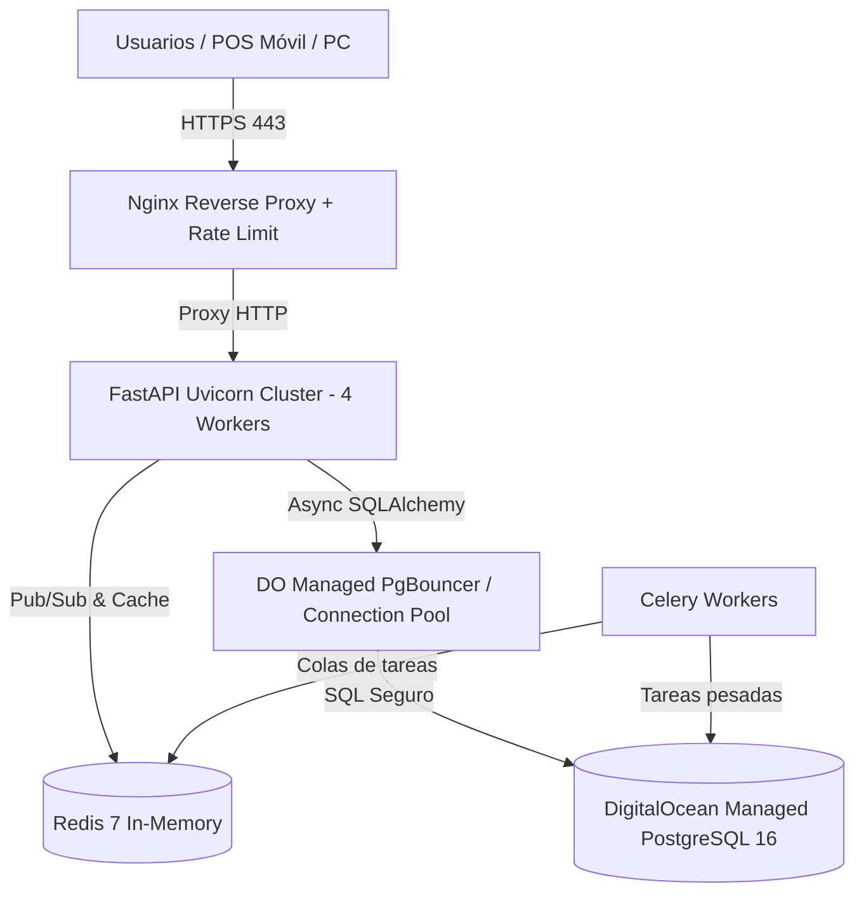

# 🛡️ Guía de Puesta en Producción: DigitalOcean & PostgreSQL
## POS Empresarial — Arquitectura de Alta Concurrencia y Máxima Seguridad

Este documento detalla todas las correcciones de seguridad aplicadas al código fuente, la configuración para **PostgreSQL**, el despliegue en **DigitalOcean** y las recomendaciones para resistir ataques y soportar alto volumen de usuarios simultáneos.

---

## 1. 🔍 Auditoría de Vulnerabilidades y Correcciones Realizadas

Durante la revisión profunda del código fuente, se identificaron y solucionaron los siguientes riesgos:

| Riesgo / Vulnerabilidad | Severidad | Estado | Solución Implementada |
| :--- | :---: | :---: | :--- |
| **Bypass de Autenticación de Administrador** (`auth.py`) | 🚨 Crítica | **ELIMINADA** | Se removió la condición de prueba que permitía iniciar sesión como `admin` con contraseñas fijas (`admin123`, `admin`). Ahora **siempre** se verifica el hash criptográfico Bcrypt. |
| **Robo de Sesión / JWT por XSS** (`auth.py`) | 🔴 Alta | **SOLUCIONADA** | Se añadieron las banderas `httponly=True` y `secure=True` (HTTPS) a la cookie `access_token`. El navegador ya no expone el token a scripts inyectados en el DOM. |
| **Ausencia de Cabeceras de Seguridad HTTP** | 🟡 Media | **SOLUCIONADA** | Se implementó el middleware `SecurityHeadersMiddleware` en FastAPI inyectando: `X-Content-Type-Options: nosniff`, `X-Frame-Options: SAMEORIGIN`, `X-XSS-Protection`, `Referrer-Policy` y `Strict-Transport-Security` (HSTS). |
| **Incompatibilidad de Sintaxis en PostgreSQL** (`database.py`) | 🔴 Alta | **SOLUCIONADA** | Las migraciones manuales usaban `BOOLEAN DEFAULT 0` (sintaxis de SQLite). En PostgreSQL esto genera error de tipo de dato; se migró a `BOOLEAN DEFAULT FALSE`. |
| **Formato de URL en DigitalOcean** (`config.py`) | 🔴 Alta | **SOLUCIONADA** | DigitalOcean entrega URLs con prefijo `postgresql://` o `postgres://`. SQLAlchemy Async requiere `postgresql+asyncpg://`. Se incorporó un validador automático que normaliza la cadena en tiempo de ejecución. |
| **Límite de Subida en Nginx (413 Payload Too Large)** | 🟡 Media | **SOLUCIONADA** | Nginx por defecto limita las peticiones a 1MB. Se configuró `client_max_body_size 25M;` y `server_tokens off;` para proteger la subida de imágenes de catálogo y fichas PDF. |

---

## 2. 🏗️ Arquitectura Recomendada en DigitalOcean

Para atender **bastantes usuarios al mismo tiempo (alta concurrencia)**, la arquitectura recomendada es:



### Opciones de Servidor en DigitalOcean:
1. **Droplet (Recomendado para la App):**
   * **Plan:** General Purpose o Basic Premium (Intel o AMD).
   * **Capacidad mínima para alta concurrencia:** 4 GB RAM, 2 vCPUs, 80 GB NVMe SSD ($24/mes).
2. **Base de Datos (PostgreSQL):**
   * **DigitalOcean Managed Database for PostgreSQL 16**:
     * Ventajas: Backups diarios automatizados, escalado en 1 clic, failover de alta disponibilidad, y conexión encriptada SSL obligatoria.
     * **Connection Pooler:** Activa **PgBouncer** integrado en modo *Transaction* en el panel de DigitalOcean.

---

## 3. 🚀 Pasos de Instalación en el Servidor DigitalOcean

### Paso 1: Configurar el Droplet Ubuntu 22.04 / 24.04 LTS
Conéctate por SSH y actualiza el sistema:
```bash
sudo apt update && sudo apt upgrade -y
sudo apt install -y curl git ufw fail2ban
```

### Paso 2: Configurar el Firewall (UFW)
Abre únicamente los puertos indispensables:
```bash
sudo ufw default deny incoming
sudo ufw default allow outgoing
sudo ufw allow 22/tcp    # SSH
sudo ufw allow 80/tcp    # HTTP (Let's Encrypt)
sudo ufw allow 443/tcp   # HTTPS
sudo ufw enable
```

### Paso 3: Instalar Docker y Docker Compose
```bash
curl -fsSL https://get.docker.com -o get-docker.sh
sudo sh get-docker.sh
sudo usermod -aG docker $USER
```

### Paso 4: Clonar el Proyecto y Preparar Entorno
```bash
git clone <URL_DE_TU_REPOSITORIO> /opt/pos-empresarial
cd /opt/pos-empresarial

# Copiar el archivo de entorno de producción
cp .env.production.example .env.production
nano .env.production
```

> [!IMPORTANT]
> **Generación de Secretos Criptográficos:**
> En tu terminal genera una clave única con:
> `openssl rand -hex 32`
> Pega este resultado en la variable `SECRET_KEY` de `.env.production`.
> Reemplaza `DATABASE_URL` con la cadena entregada por tu base de datos PostgreSQL de DigitalOcean.

### Paso 5: Generar Certificado SSL Gratuito con Let's Encrypt (Certbot)
```bash
sudo apt install -y certbot python3-certbot-nginx
sudo certbot certonly --standalone -d tudominio.com -d pos.tudominio.com
```

### Paso 6: Iniciar los Contenedores de Producción
```bash
docker compose -f docker-compose.prod.yml up -d --build
```

Verificar que todos los servicios estén saludables (`healthy`):
```bash
docker compose -f docker-compose.prod.yml ps
```

---

## 4. ⚡ Optimización para Alta Concurrencia

1. **Uvicorn con Múltiples Workers:**
   * En `docker-compose.prod.yml` el backend se ejecuta con `--workers 4`. Cada worker es un proceso Python independiente capaz de atender miles de peticiones asíncronas con `asyncpg`.
2. **PostgreSQL Connection Pool:**
   * En `.env.production`:
     * `DB_POOL_SIZE=20`: Mantiene 20 conexiones persistentes abiertas listas para consultas instantáneas.
     * `DB_MAX_OVERFLOW=30`: Permite picos temporales de hasta 50 conexiones simultáneas sin rechazar peticiones.
     * `DB_PGBOUNCER=true`: Si activas el pooler de DigitalOcean, desactiva la caché de sentencias preparadas de asyncpg para evitar colisiones.
3. **Caché en Redis:**
   * El catálogo de productos y sesiones de usuario utilizan Redis para evitar consultar la base de datos en peticiones repetitivas de lectura.

---

## 5. 🛡️ Medidas Adicionales Contra Hackers y Ataques

1. **Protección contra Fuerza Bruta (Nginx Rate Limiting):**
   * El endpoint `/api/v1/auth/login` está limitado a **5 intentos por minuto por IP** (`limit_req zone=login burst=3 nodelay;`). Un atacante con scripts automatizados será bloqueado inmediatamente.
2. **Protección contra Inyección SQL:**
   * El 100% de las consultas del sistema utilizan el ORM SQLAlchemy con sentencias parametrizadas (`select(...)`), imposibilitando ataques de inyección SQL estándar.
3. **Protección contra Clickjacking y XSS:**
   * Las cabeceras `X-Frame-Options: SAMEORIGIN` impiden que el sistema sea incrustado en iframes de sitios externos fraudulentos.
4. **Deshabilitar Acceso SSH con Contraseña:**
   * En `/etc/ssh/sshd_config` establece `PasswordAuthentication no` y utiliza únicamente llaves SSH (`ed25519` o `rsa 4096`).
5. **Backups Automatizados:**
   * Configura en DigitalOcean los snapshots automáticos semanales del Droplet y backups diarios con Point-In-Time-Recovery (PITR) en la base de datos PostgreSQL.
