# 🏢 Documentación Integral del Sistema: POS Empresarial ERP 360°

> **Plataforma Integral de Gestión Comercial, Punto de Venta Touch / Offline, Facturación Electrónica SAT (FEL), Inventario Multi-Bodega, Cuentas por Pagar/Cobrar y Contabilidad Automatizada.**
> 
> *Versión del Sistema:* `2.5.0 Enterprise`  
> *Normativa Fiscal:* `Guatemala FEL (Decreto SAT 20-2006 / Acuerdo Directorio 13-2018)`  
> *Stack Tecnológico:* `FastAPI (Python 3.14) · SQLAlchemy Async · SQLite / PostgreSQL · Alpine.js · Vanilla CSS Odoo Enterprise Edition`

---

## 📑 Tabla de Contenidos

1. [Visión General & Arquitectura Técnica](#1-visión-general--arquitectura-técnica)
2. [Diagrama de Flujo de Datos End-to-End](#2-diagrama-de-flujo-de-datos-end-to-end)
3. [Módulos del Sistema](#3-módulos-del-sistema)
   - [3.1. Dashboard Ejecutivo & Centro de Control](#31-dashboard-ejecutivo--centro-de-control)
   - [3.2. Punto de Venta Touch & Modo Offline (POS)](#32-punto-de-venta-touch--modo-offline-pos)
   - [3.3. Inventarios & Catálogo Multi-Bodega](#33-inventarios--catálogo-multi-bodega)
   - [3.4. Cotizaciones & Conversión a Venta](#34-cotizaciones--conversión-a-venta)
   - [3.5. Compras & Recepción de Mercancías](#35-compras--recepción-de-mercancías)
   - [3.6. Cuentas por Pagar (AP & Aging Report)](#36-cuentas-por-pagar-ap--aging-report)
   - [3.7. Directorio 360° de Clientes y Proveedores](#37-directorio-360-de-clientes-y-proveedores)
   - [3.8. Traslados entre Sucursales](#38-traslados-entre-sucursales)
   - [3.9. Bodegas & Ubicaciones](#39-bodegas--ubicaciones)
   - [3.10. Contabilidad & Libro Mayor](#310-contabilidad--libro-mayor)
   - [3.11. Reportes, Libro FEL & Business Intelligence](#311-reportes-libro-fel--business-intelligence)
   - [3.12. Manufactura & Producción (BOM)](#312-manufactura--producción-bom)
   - [3.13. Recursos Humanos & Control de Personal](#313-recursos-humanos--control-de-personal)
   - [3.14. Auditoría & Trazabilidad de Eventos](#314-auditoría--trazabilidad-de-eventos)
   - [3.15. Configuración de Empresa & Emisor FEL](#315-configuración-de-empresa--emisor-fel)
4. [Esquema de Base de Datos y Entidades Clave](#4-esquema-de-base-de-datos-y-entidades-clave)
5. [Seguridad y Control de Acceso (RBAC)](#5-seguridad-y-control-de-acceso-rbac)
6. [Guía de Despliegue y Puesta en Marcha](#6-guía-de-despliegue-y-puesta-en-marcha)

---

## 1. Visión General & Arquitectura Técnica

POS Empresarial es una solución ERP diseñada para empresas comerciales y de distribución en Guatemala y Latinoamérica. Integra en una única base de datos transaccional todos los flujos comerciales, desde la cotización y el cobro en terminales touch (con capacidad de seguir operando sin conexión a internet mediante IndexedDB), hasta la emisión de Documentos Tributarios Electrónicos (DTE FEL con firma digital y QR), control de inventario en tiempo real con lotes y vencimientos, y la generación automática de partidas contables bajo el principio de partida doble.

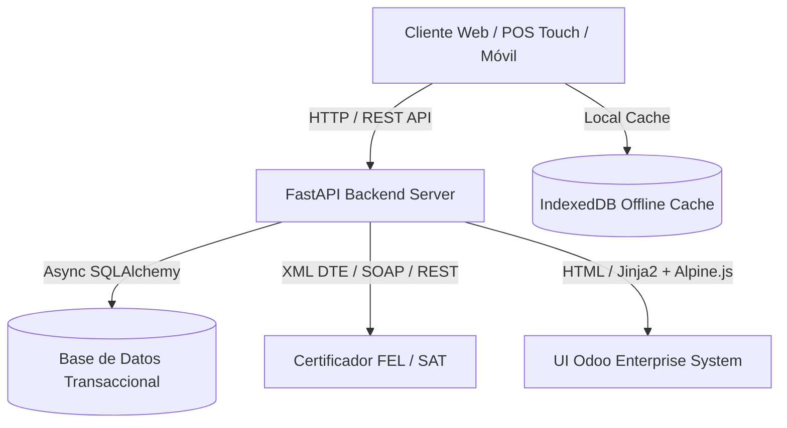

### Características Principales:
- **Backend Asíncrono de Alto Rendimiento:** Desarrollado con FastAPI, Pydantic v2 y SQLAlchemy 2.0 Asyncio.
- **Frontend Ultraligero y Reactivo:** Impulsado por Alpine.js y Vanilla CSS estructurado con la paleta de colores y lineamientos visuales de Odoo Enterprise (`#714B67`).
- **Resiliencia Operativa Offline:** El Punto de Venta sincroniza catálogo y almacena ventas localmente en `IndexedDB`, sincronizándolas automáticamente al restaurarse la conectividad.
- **Certificación FEL Nativa:** Generación de DTE (Facturas, Facturas Especiales, Notas de Crédito, Notas de Abono) con validación de NIT SAT y código QR.

---

## 2. Diagrama de Flujo de Datos End-to-End

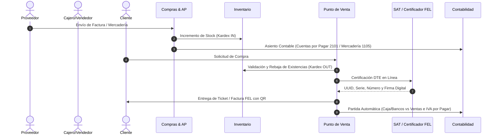

---

## 3. Módulos del Sistema

---

### 3.1. Dashboard Ejecutivo & Centro de Control
- **Ruta:** `/dashboard`
- **Propósito:** Ofrecer a la gerencia y supervisores una vista panorámica instantánea de la operación comercial y financiera del día.
- **Funciones Principales:**
  - Métricas de ventas totales del día, transacciones emitidas y ticket promedio.
  - Alertas de inventario bajo stock mínimo y productos próximos a vencer.
  - Indicador de estado de caja abierta y disponibilidad de fondos.
  - Accesos directos rápidos a las funciones operativas de mayor uso.
- **Flujo de Datos:** Consolida en memoria y agregaciones SQL las ventas registradas por todas las cajas activas, los movimientos de kardex y el estado de cartera de cobro.

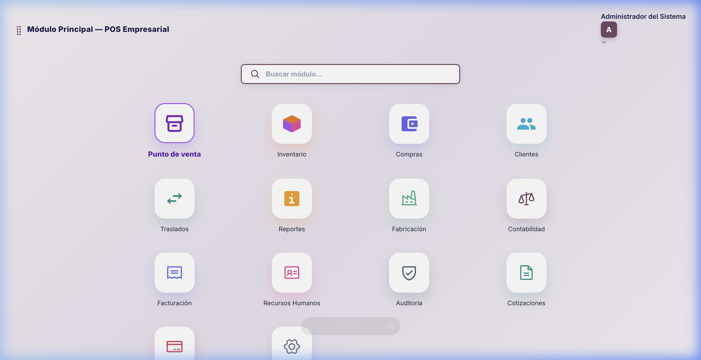

---

### 3.2. Punto de Venta Touch & Modo Offline (POS)
- **Ruta:** `/pos`
- **Propósito:** Terminal de venta ágil diseñada para pantallas táctiles y lectores de código de barras, con cobro rápido y facturación FEL inmediata.
- **Funciones Principales:**
  - Catálogo interactivo de productos con selector de categorías y búsqueda instantánea por código de barras / nombre.
  - Soporte de múltiples métodos de pago combinados: Efectivo en Quetzales/Dólares, Tarjeta de Crédito/Débito, Transferencia Bancaria y Crédito Directo.
  - Apertura, arqueo y corte de caja (Cierre Z / Cierre X) con desglose de denominaciones.
  - **Soporte Offline:** Guarda transacciones en el navegador si se cae la red y las envía al servidor al restablecerse la conexión.
  - Emisión e impresión de tickets térmicos con código QR de SAT.
- **Flujo de Datos:** Valida stock en bodega seleccionada -> descuenta unidades en Kardex -> emite DTE a SAT -> actualiza balance del turno de caja -> genera asiento contable.

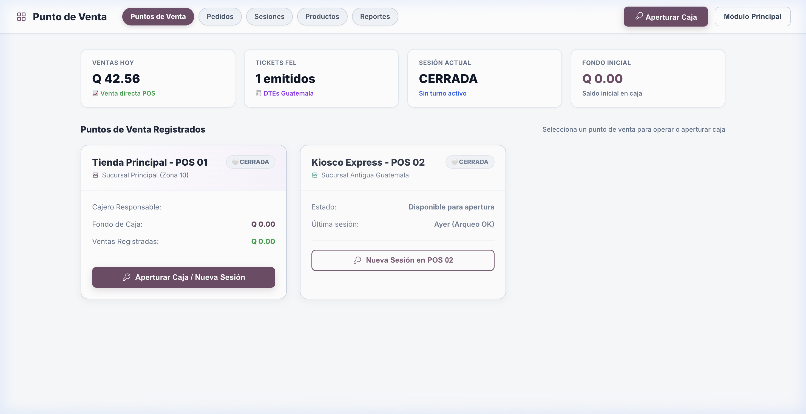

---

### 3.3. Inventarios & Catálogo Multi-Bodega
- **Ruta:** `/inventory`
- **Propósito:** Administración centralizada de productos, existencias en múltiples bodegas, control de lotes con fecha de caducidad y trazabilidad Kardex.
- **Funciones Principales:**
  - Panel flotante de resumen `[ 📊 Resumen ⌵ ]` con valor total del inventario, productos activos, alertas de stock mínimo y lotes por vencer.
  - Catálogo maestro de productos con imágenes, precios al por mayor/menor, código de barras y SKU.
  - Trazabilidad Kardex por producto (entradas, salidas, ajustes y traslados con costo promedio ponderado).
  - Impresión de etiquetas con código de barras y fecha de vencimiento.
- **Flujo de Datos:** Modificado por compras (+), ventas (-), traslados (+/-) y ajustes de auditoría física.

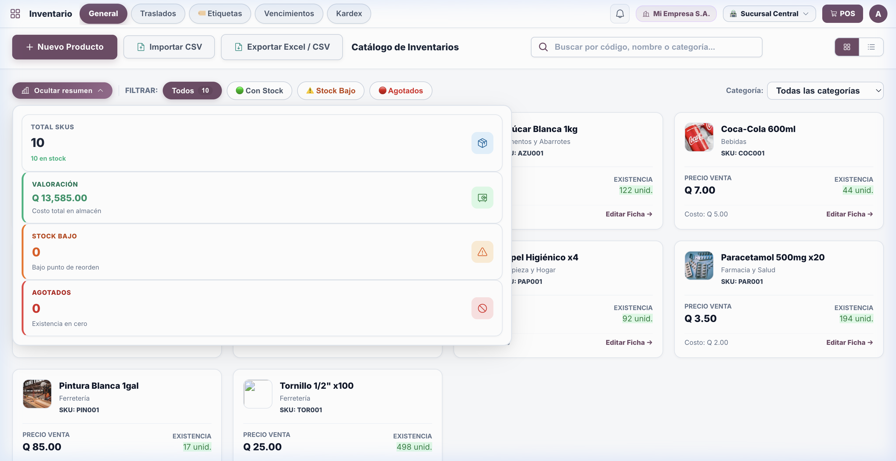

---

### 3.4. Cotizaciones & Conversión a Venta
- **Ruta:** `/quotes`
- **Propósito:** Emisión formal de proformas comerciales para clientes, cálculo de vigencia y conversión automática en venta/factura con un solo clic.
- **Funciones Principales:**
  - Creación de cotizaciones con desglose de impuestos (IVA), descuentos por línea y notas comerciales.
  - Envío digital y exportación en formato PDF imprimible.
  - Botón de conversión rápida a orden de venta directa sin necesidad de re-digitar los ítems.
- **Flujo de Datos:** Permanece en estado borrador/enviada sin alterar inventario hasta que el usuario ejecuta la conversión a venta.

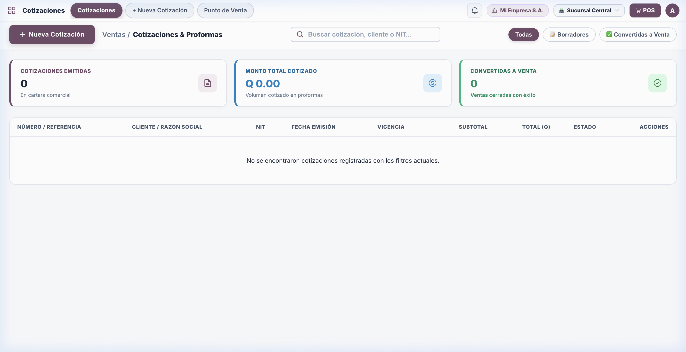

---

### 3.5. Compras & Recepción de Mercancías
- **Ruta:** `/purchases`
- **Propósito:** Gestión integral del ciclo de abastecimiento a proveedores, recepción física en bodega e ingreso automático a Cuentas por Pagar.
- **Funciones Principales:**
  - Registro de órdenes de compra con proveedores asociados (con NIT y datos fiscales).
  - Recepción de mercadería con asignación opcional de número de lote y fecha de vencimiento.
  - Creación automática de la factura por pagar vinculada en el módulo de AP.
- **Flujo de Datos:** Orden de compra -> Recepción de mercadería (Kardex IN) -> Generación de pasivo en `ap_invoices` -> Partida de diario contable.

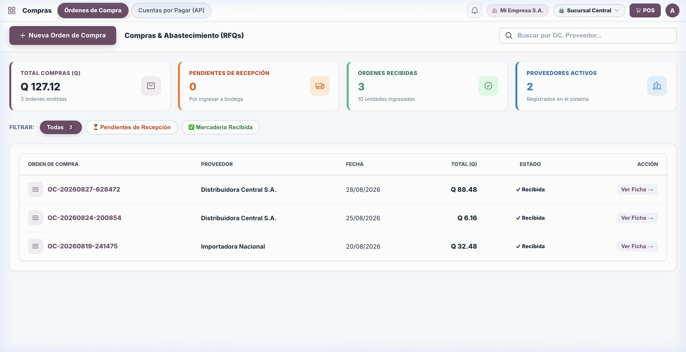

---

### 3.6. Cuentas por Pagar (AP & Aging Report)
- **Ruta:** `/ap`
- **Propósito:** Monitoreo y liquidación de obligaciones financieras con proveedores, análisis de vencimientos y registro de abonos.
- **Funciones Principales:**
  - Panel flotante de resumen `[ 📊 Resumen ⌵ ]` con deuda total acumulada, facturas vencidas y compras del mes.
  - Reporte de Antigüedad de Saldos (*Aging Report: Corriente, 1-30 días, 31-60 días, 61-90 días, +90 días*).
  - **Asistente de Registro de Pagos Estilo Odoo Enterprise:** Modal estructurado con selección de diario (Caja/Bancos), fecha, cuenta receptora y cálculo automático de diferencia de pago.
  - Emisión de Comprobantes Oficiales de Pago / Egreso con correlativo contable.
- **Flujo de Datos:** Disminuye el saldo adeudado de la factura del proveedor -> genera egreso de caja/banco -> registra asiento contable de débito a proveedores y crédito a banco.

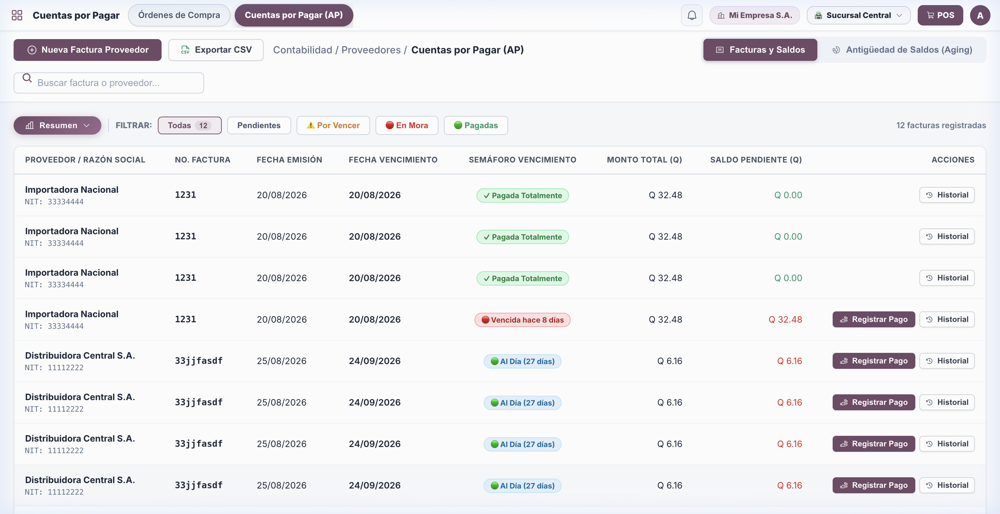

---

### 3.7. Directorio 360° de Clientes y Proveedores
- **Ruta:** `/customers`
- **Propósito:** Gestión unificada de terceros (CRM comercial, límites de crédito, saldos pendientes y estados de cuenta).
- **Funciones Principales:**
  - Vista Kanban estilo Odoo Enterprise con avatares individuales/empresariales y badges limpios sin contornos duros.
  - Panel flotante `[ 📊 Resumen ⌵ ]` con directorio activo, cartera por cobrar y porcentaje de uso de crédito global.
  - Segmentación instantánea: *Clientes, Proveedores, Con Saldo Pendiente, Con Línea de Crédito, Empresas S.A.*
  - Enlace directo a WhatsApp en un solo clic y registro de abonos rápidos.
  - Expediente 360° con historial completo de compras, pagos y estado de cuenta descargable.
- **Flujo de Datos:** Alimenta la selección de clientes en el POS y cotizaciones, y proveedores en compras y cuentas por pagar.

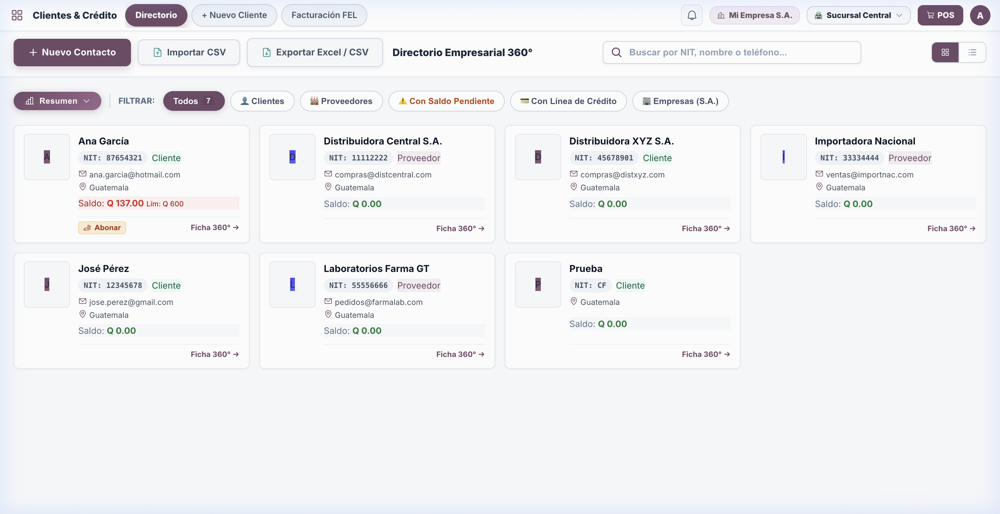

---

### 3.8. Traslados entre Sucursales
- **Ruta:** `/transfers`
- **Propósito:** Movimiento seguro de mercadería entre bodegas y sucursales con flujo de despacho, tránsito y confirmación de recepción.
- **Funciones Principales:**
  - Solicitud y autorización de traslados con bodega de origen y destino.
  - Control de estado de mercadería en tránsito.
  - Verificación física al recibir en destino y ajuste automático en existencias de ambas bodegas.
- **Flujo de Datos:** Genera dos movimientos de Kardex: salida en origen y entrada en destino.

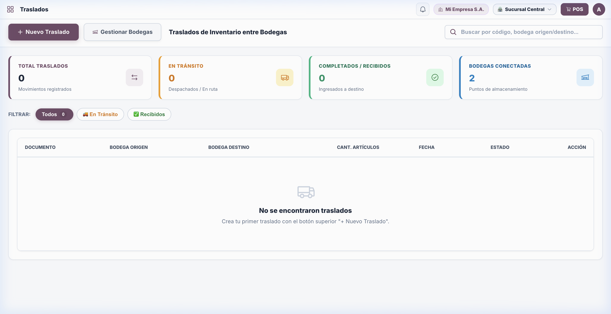

---

### 3.9. Bodegas & Ubicaciones
- **Ruta:** `/warehouses`
- **Propósito:** Configuración de la red física de almacenamiento de la empresa (bodegas principales, sucursales y salas de venta).
- **Funciones Principales:**
  - Alta y administración de bodegas asociadas a cada sucursal física.
  - Marcado de bodega predeterminada para operaciones de mostrador.
  - Consulta de existencias consolidadas por centro de almacenamiento.
- **Flujo de Datos:** Estructura jerárquica utilizada por inventario, compras, ventas y traslados.

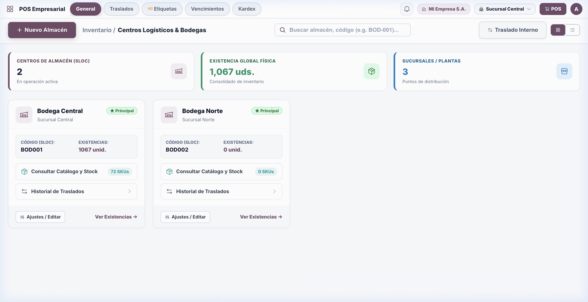

---

### 3.10. Contabilidad & Libro Mayor
- **Ruta:** `/accounting`
- **Propósito:** Motor contable formal bajo estándares de partida doble, catálogo de cuentas guatemalteco y generación de estados financieros.
- **Funciones Principales:**
  - Panel flotante `[ 📊 Resumen ⌵ ]` con Ingresos por Ventas, Costo de Ventas (COGS), Utilidad Neta y Total de Activos.
  - **Libro Diario & Asientos:** Visualización e ingreso manual de partidas con cuadre estricto de Debe y Haber.
  - **Catálogo de Cuentas (Nomenclatura):** Clasificación de Activo, Pasivo, Capital, Ingreso, Costo y Gasto.
  - **Balance de Comprobación (Trial Balance):** Cuadre de sumas y saldos.
  - **Estado de Resultados (P&L):** Cálculo dinámico de utilidad bruta y neta.
- **Flujo de Datos:** Recibe partidas automáticas desde Ventas POS, Compras y Abonos de AP, además de partidas manuales de ajuste.

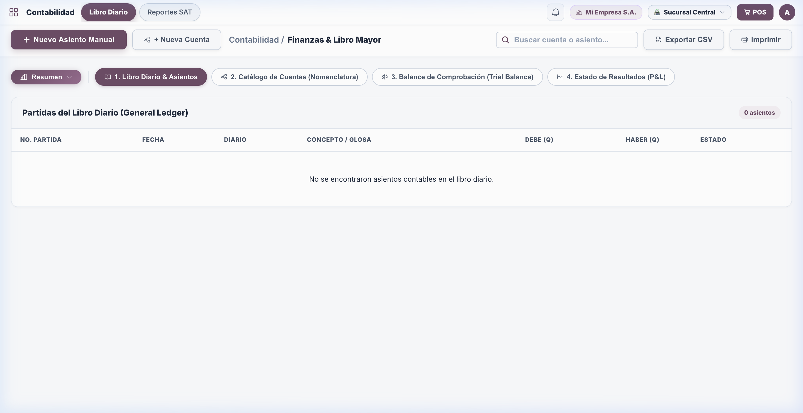

---

### 3.11. Reportes, Libro FEL & Business Intelligence
- **Ruta:** `/reports`
- **Propósito:** Inteligencia de negocios, análisis de rentabilidad y generación del Libro Oficial de Ventas exigido por SAT.
- **Funciones Principales:**
  - Panel flotante `[ 📊 Resumen ⌵ ]` con facturación mensual, IVA generado, transacciones FEL certificadas y margen bruto promedio.
  - Libro de Ventas Tributario descargable en Excel/CSV con NIT, número de DTE, serie, UUID y monto gravado/exento.
  - Análisis Pareto 80/20 de productos más vendidos y clientes de mayor volumen.
  - Reporte de turnos y cortes de caja por operador.
- **Flujo de Datos:** Extrae datos históricos de ventas, documentos FEL y movimientos de caja.

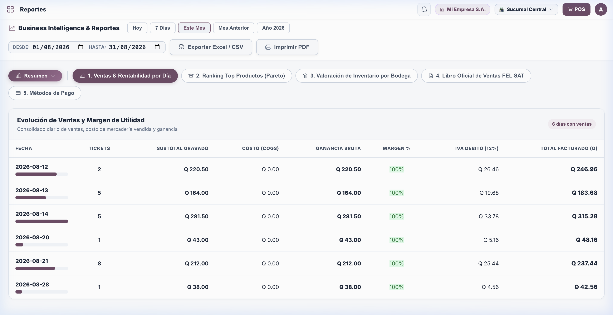

---

### 3.12. Manufactura & Producción (BOM)
- **Ruta:** `/mfg`
- **Propósito:** Gestión de procesos de ensamble, transformación y fabricación de productos terminados a partir de materias primas.
- **Funciones Principales:**
  - Definición de recetas y Listas de Materiales (Bill of Materials - BOM).
  - Generación de Órdenes de Producción con cálculo de costos unitarios.
  - Rebaja automática de materias primas y alta de producto terminado en inventario.
- **Flujo de Datos:** Descuenta materias primas del Kardex e ingresa las unidades producidas del producto final.

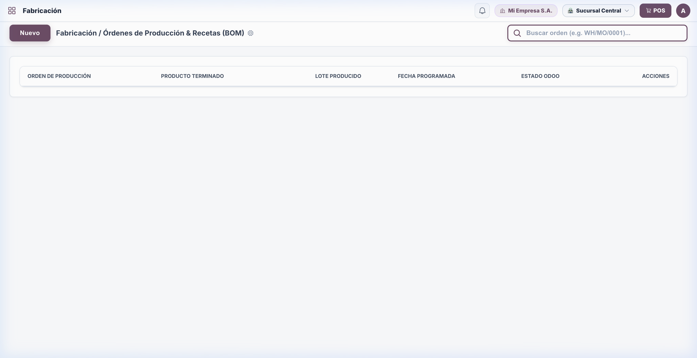

---

### 3.13. Recursos Humanos & Control de Personal
- **Ruta:** `/hr`
- **Propósito:** Administración de expedientes de colaboradores, asignación de turnos laborales y cálculo básico de planillas.
- **Funciones Principales:**
  - Fichero de empleados con puesto, salario base, sucursal asignada y datos de contacto.
  - Registro de asistencias y asignación a turnos de caja POS.
- **Flujo de Datos:** Vincula a los usuarios del sistema con sus respectivos perfiles de empleados y permisos.

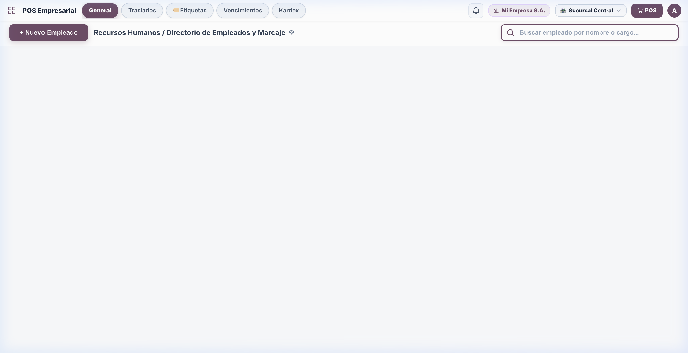

---

### 3.14. Auditoría & Trazabilidad de Eventos
- **Ruta:** `/audit`
- **Propósito:** Registro inmutable de seguridad para cumplimiento normativo y trazabilidad de todas las acciones críticas en el sistema.
- **Funciones Principales:**
  - Bitácora de accesos, modificaciones de precios, anulaciones de documentos, aperturas de caja y eliminaciones.
  - Registro de IP de origen, usuario responsable, marca de tiempo y detalle de la operación.
- **Flujo de Datos:** Middleware automático que intercepta peticiones API y almacena eventos en la tabla `audit_logs`.

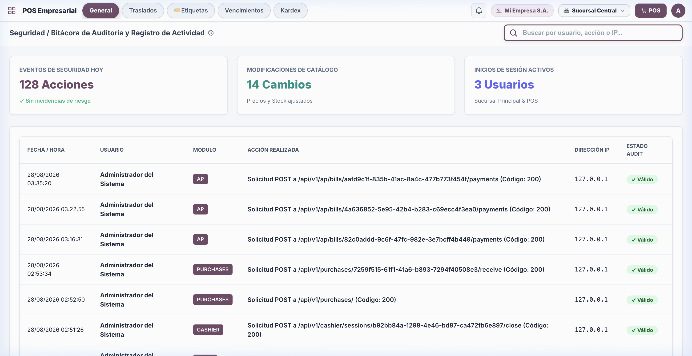

---

### 3.15. Configuración de Empresa & Emisor FEL
- **Ruta:** `/companies`
- **Propósito:** Configuración de la entidad legal, sucursales autorizadas y credenciales del certificador FEL ante la SAT.
- **Funciones Principales:**
  - Datos de la empresa: Razón Social, Nombre Comercial, NIT, Régimen de Impuesto (General / Pequeño Contribuyente).
  - Configuración del Certificador DTE (URL del API, Token de autenticación, Llave de firma y Frases tributarias).
  - Parámetros generales del sistema (moneda GTQ/USD, formato de fecha `DD/MM/YYYY`, logo corporativo).
- **Flujo de Datos:** Provee los parámetros globales para la certificación de documentos y encabezados de reportes.

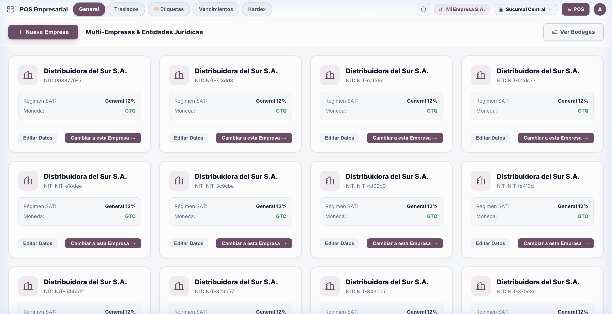

---

## 4. Esquema de Base de Datos y Entidades Clave

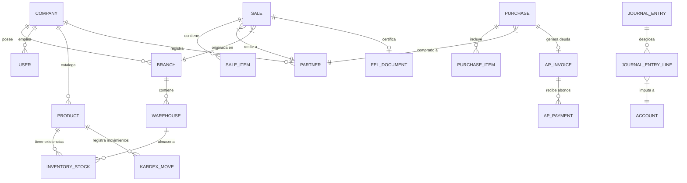

---

## 5. Seguridad y Control de Acceso (RBAC)

El sistema implementa un modelo de seguridad basado en roles (RBAC) con permisos granulares:

| Rol del Sistema | Permisos Clave | Acceso a Módulos |
| :--- | :--- | :--- |
| **Administrador** | Acceso total (`*`), configuración de empresa, FEL, auditoría y reportes. | Todos los módulos. |
| **Supervisor** | Aprobación de compras, traslados, ajustes de stock y arqueos de caja. | POS, Inventario, Compras, AP, Reportes. |
| **Cajero / Vendedor** | Apertura/cierre de caja, emisión de ventas POS, consulta de catálogo y clientes. | POS, Clientes (consulta), Cotizaciones. |
| **Encargado de Inventario** | Recepción de compras, traslados entre bodegas, kardex y ajustes de producto. | Inventario, Bodegas, Traslados, Compras. |

---

## 6. Guía de Despliegue y Puesta en Marcha

### Requisitos Previos:
- Python 3.11 o superior (compatible con Python 3.14).
- Base de datos SQLite (desarrollo/cajas locales) o PostgreSQL (producción multi-sucursal).
- Conexión HTTPS para el endpoint de facturación electrónica SAT.

### Comandos de Ejecución Local:
```bash
# 1. Clonar repositorio y entrar al directorio
cd pos-empresarial

# 2. Activar entorno virtual
source venv/bin/activate

# 3. Inicializar base de datos y datos semilla (si aplica)
PYTHONPATH=backend ./venv/bin/python scripts/seed.py

# 4. Iniciar servidor FastAPI
./venv/bin/python main.py
```

### Acceso a la Plataforma:
- **URL Local:** `http://localhost:8000`
- **Usuario Administrador:** `admin@empresa.com`
- **Contraseña:** `Admin2024!`
- **Documentación OpenAPI / Swagger:** `http://localhost:8000/docs`

---
*Documento generado y validado con éxito para importación directa en Notion.*
